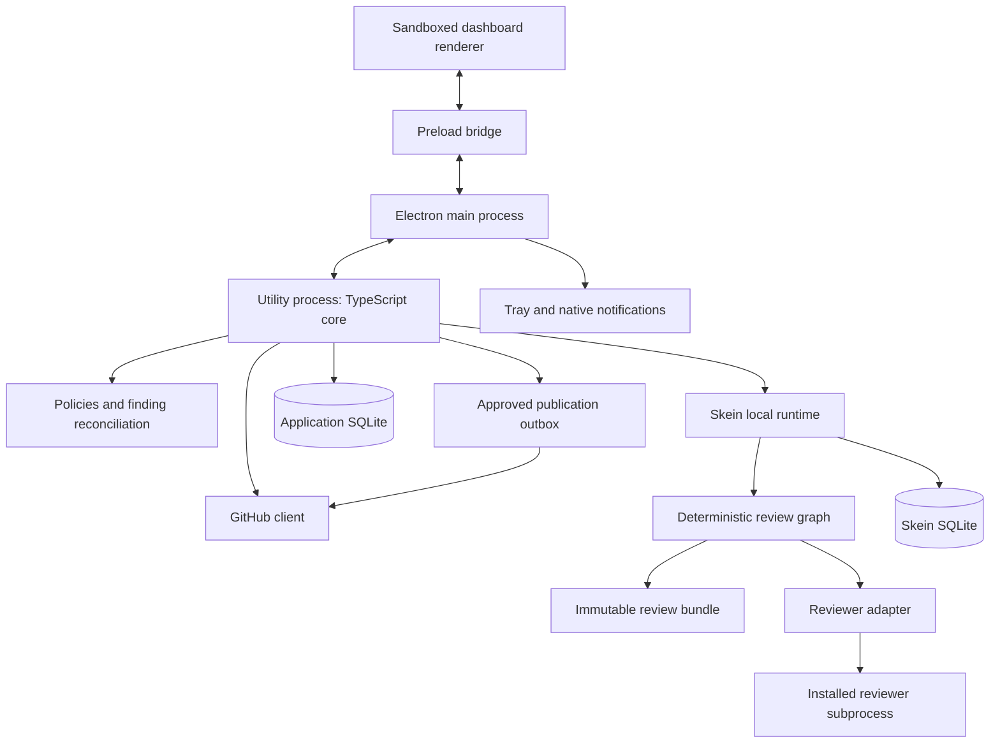

# Architecture

**Status:** Proposed MVP architecture; [Electron is accepted](decisions/0001-electron.md).  
**Design baseline:** 2026-11-13

## Design principles

Selvedge keeps orchestration and review history local. Scheduling, admission,
state transitions, retries, and publication checks are deterministic. Code
reasoning belongs to the selected coding agent. Prior-finding assessment should
share the normal review invocation where practical, avoiding a separate model
call for routine bookkeeping.

The TypeScript review core has no dependency on Electron. Desktop and future
headless hosts provide lifecycle, credential access, and user interaction. No
message broker, remote control plane, semantic index, or additional agent
framework is required.

Local-first describes state ownership and execution location. Source context
normally reaches the coding agent's configured model provider.

## Processes and boundaries

| Component             | Responsibility                                                                                                               |
| --------------------- | ---------------------------------------------------------------------------------------------------------------------------- |
| Electron main         | Single application instance, utility-process supervision, windows, tray, notifications, and OS credential-store bridge       |
| Preload and renderer  | Narrow validated commands and paginated queries; no raw filesystem, database, arbitrary shell, or GitHub-token access        |
| Review core           | Repository discovery, immutable targets, policy, review requests, attempts, finding history, publication, and diagnostics    |
| Skein integration     | Embedded SQLite runtime, graph registration, native admission receipts, background workers, scheduling, and retained results |
| Reviewer adapters     | Supported CLI detection, safe launch profile, structured output, progress, deadlines, cancellation, and process cleanup      |
| Workspace preparation | Trusted Git operations and bounded source extraction from exact revisions                                                    |
| Persistence           | Application transactions, migrations, deduplication, recovery records, and retention                                         |

Use Electron IPC and the utility-process message channel for local operations.
Validate payloads at each boundary and validate the renderer's sender identity.
Expose specific actions, not arbitrary Skein administration or command execution.
The MVP needs no local HTTP server. Electron utility-process separation improves
failure isolation; it does not sandbox an agent running with user credentials.

Destroy the dashboard when its window closes. Keep the main and utility processes
alive for monitoring. Explicit Quit stops new admission, drains within a bounded
grace period, cancels remaining attempts, terminates their process trees, stops
the runtime, and disposes storage. A utility-process crash triggers bounded host
restart and reconciliation. Repeated failures surface an actionable paused state.

The system cannot review while asleep or off. On launch, wake, or reconnection,
reconcile current GitHub state instead of replaying every missed poll. The MVP
does not guarantee observing every transient commit between polls.

## Verified Skein integration

This design was checked against Skein commit
`a241ff0edec2159c49f27c68f975b4a1b2b385f7`. Refer to the pinned
[local implementation](https://github.com/skein-js/skein-js/blob/a241ff0edec2159c49f27c68f975b4a1b2b385f7/packages/local/src/index.ts),
[local deployment contract](https://github.com/skein-js/skein-js/blob/a241ff0edec2159c49f27c68f975b4a1b2b385f7/docs/local-deployment.md),
and [native access contract](https://github.com/skein-js/skein-js/blob/a241ff0edec2159c49f27c68f975b4a1b2b385f7/docs/native-access.md).

- `embedSqliteGraphs` assembles local dependencies and LangGraph's SQLite
  checkpointer. The host registers graphs and starts and stops the runtime.
- `createProtocolRuntime` supplies the worker and scheduler;
  `createNativeClient` supplies start, cancel, receipt, state, and result access
  without HTTP. Admission retries use stable source identity and idempotency keys.
- LangGraph defines the deterministic graph. It is already part of Skein's graph
  execution model; no LLM or separate agent framework is needed in these nodes.
- Queued, unclaimed SQLite work survives restart. Abandoned executions become
  errors with `ProcessLostError`; SQLite does not automatically replay input.
- Cancellation propagates a cooperative signal. The reviewer adapter must stop
  its subprocesses and reject late results.
- Native receipts and results have retention boundaries. Selvedge's persistent
  business records must preserve deduplication beyond runtime receipt expiry.
- SQLite has one process owner. The desktop and a future headless host cannot
  independently open the same runtime file at the same time.

Use the local entry points rather than importing a general server assembly with
unused remote drivers. Pin and test actual published package versions during
feasibility; source inspection alone does not establish npm availability or
Electron ABI compatibility. Override Skein's worker concurrency explicitly;
Selvedge must not inherit a server-oriented concurrency default accidentally.

Skein's scheduler triggers bounded discovery and reconciliation work. Persist
per-repository due times and backoff so schedules can be reconstructed after
restart. A minute-level scheduled discovery pass is sufficient for the proposed
polling default; delayed native runs handle debounce and retries where supported.
Do not keep a graph invocation alive merely to sleep between polls. Agent
concurrency is a separate limit, so a long review cannot starve discovery or
publication reconciliation.

## Persistence and identity

One utility process owns two local SQLite files in the OS application-data
directory:

| File or artifact           | Ownership and purpose                                                                                                  |
| -------------------------- | ---------------------------------------------------------------------------------------------------------------------- |
| Application database       | Selvedge migrations, repositories, targets, review requests, attempts, findings, publication, and notification records |
| Runtime database           | Skein-managed runs, receipts, queue records, checkpoints, and results; no direct edits to runtime internals            |
| Private artifact directory | Bounded review bundles, CLI output, and validated result artifacts with hashes and retention                           |
| OS credential store        | GitHub access and refresh credentials; no secrets in SQLite or renderer storage                                        |

Two files keep migrations and ownership independent. No cross-file atomicity is
assumed. The application commits a review request and attempt before admission,
then admits it using that attempt's stable key. A reconciler recovers the same
receipt if the process dies before recording its run ID. It imports terminal
results into the application database idempotently. These records are dispatch
intent, not a second execution queue or workflow engine.

The logical review identity includes GitHub host, immutable repository ID, PR
number, head SHA, base SHA, merge-base SHA, reviewer configuration revision, and
policy/prompt/schema versions. A uniqueness constraint suppresses repeated
discovery of the same target and configuration. Explicit re-review creates a
recorded generation; an execution retry creates a new attempt under the same
logical request. Every attempt has its own stable runtime admission key.

Persist immutable finding observations separately from logical findings and user
decisions. Relevant records include repositories and poll state, PR snapshots,
review requests and attempts, finding observations and lineage, publication
intents and remote IDs, and notification receipts. Store review coverage and
failure reasons alongside results. Keep transcript-sized data outside dashboard
queries and avoid duplicating large source bundles in graph state.

## Review lifecycle

1. **Discover:** Fetch paginated PR metadata, reconcile tracked PRs, and evaluate
   user policy. Conditional requests, serialized API access, jitter, and
   server-directed backoff limit polling cost.
2. **Capture:** Snapshot exact target SHAs, trusted policy, and reviewer
   configuration. Debounce observed pushes before creating eligible work.
3. **Admit:** Persist intent and use the native client with a stable attempt key.
   Recheck eligibility and target freshness immediately before expensive work.
4. **Prepare:** Fetch only required Git objects through trusted operations and
   assemble a bounded, immutable bundle with source locations and exclusions.
5. **Review:** Run the configured CLI with the supported safety profile, deadline,
   progress capture, and cancellation signal. Include prior findings for explicit
   assessment within this invocation.
6. **Validate:** Check the process outcome, provider envelope, schema, paths,
   revision references, coverage, and bounded content. Save a validated artifact
   atomically with attempt identity and an integrity hash.
7. **Persist:** In one application transaction, import the review and finding
   observations, update current projections, and record notification intent.
8. **Present:** Show a private result with its exact target and coverage. A stale
   result remains historical and cannot replace the current target's projection.

The graph handles preparation, review, validation, and result production. Business
records drive idempotent projection into the application database. Publication is
a separate explicit command; a completed review does not retain an agent process
while waiting for a person.

New heads, retargeting, and relevant base changes supersede queued work. Request
cancellation of active superseded attempts, wait for confirmed termination before
reusing their agent capacity, and discard late output from current-state updates.
Closed or merged PRs stop scheduling while retaining history. A user cancellation
is terminal until a later eligible target or explicit retry; polling must not
immediately recreate the cancelled request.

Transient failures receive bounded backoff. Authentication and quota failures
pause the provider and expose remediation. Do not blindly retry malformed output,
unsupported capabilities, security failures, or an ambiguous external effect.
Record attempts and available usage so retries are visible. Missing pricing or
quota-reset information is unknown, not zero cost or an invented reset time.

## Restart and interruption recovery

On startup, obtain exclusive ownership, migrate application state, assemble the
runtime, and reconcile before admitting replacements:

1. Recover admissions with their stable attempt keys and inspect recorded runs.
2. Import retained successful results that did not reach application persistence.
3. Inspect atomically saved result artifacts for process-lost attempts. Adopt one
   only after checking completeness, identity, integrity, cancellation, and
   freshness; otherwise retain it as diagnostic evidence.
4. Confirm that orphaned reviewer processes have stopped before starting another
   attempt. Use verifiable process identity and platform ownership mechanisms;
   a stored PID alone cannot authorize termination of an unrelated process.
5. Retry only still-current eligible work within its persisted attempt budget.
   Preserve explicit cancellation and provider pauses.
6. Reconcile publication and notification intents independently. Never replay a
   GitHub post merely because its local acknowledgement is missing.

Recovery is not a promise to resume the CLI's internal reasoning. The MVP may
restart a safe read-only review from its immutable input and charge another
attempt. Skein checkpoints do not capture an external process's execution state.

If later interactions use LangGraph interrupts, resume with the expected run and
checkpoint through the native contract. An approval interrupt is distinct from a
crash or cancellation. Do not put irreversible side effects before an interrupt
in a node that may execute again.

## Reviewer adapter contract

This is a conceptual contract, not an implemented TypeScript interface.

| Surface                 | Required information or behavior                                                                                                                                                     |
| ----------------------- | ------------------------------------------------------------------------------------------------------------------------------------------------------------------------------------ |
| Installation inspection | Executable path and version, provider identity, supported output/safety features, authentication readiness where observable, and unsupported reasons                                 |
| Review input            | Request and attempt IDs, exact target, immutable bundle, trusted policy, prior observations, schema version, absolute deadline, cancellation signal, and progress sink               |
| Review output           | Completion status, structured findings, assessment of each prior finding, coverage/exclusions, provider/version/model where reported, usage where available, and artifact references |
| Failure                 | Typed distinction between authentication, quota, transient infrastructure, unsupported version, invalid output, timeout, cancellation, and safety failure                            |
| Lifecycle               | Noninteractive execution, bounded output, full owned-process-tree termination, and no detached work                                                                                  |

Findings carry severity, explanation, suggested improvement, code evidence, and
validated file/line/side references where available. Non-inline findings remain
possible. Suggested improvements are advisory text, never applied edits.

Codex uses its documented noninteractive execution and output schema. Claude
uses its documented print mode and structured-output envelope. Validate provider
events and final output separately: exit zero or missing findings does not prove
completion. Maintain fixtures for tested CLI versions and reject unsupported
safety behavior rather than silently falling back to prose scraping.

Authentication remains owned by the installed CLI. Let users sign in through the
provider's official flow; do not extract or copy subscription tokens. Invoke the
unmodified installation under the user's chosen supported authentication method.
Account entitlement, organization policy, and quota still apply. A switch to API
billing requires explicit configuration.

Claude's documented bare automation mode skips configuration discovery but also
skips subscription credentials. A safe subscription-compatible profile therefore
requires separate verification. This is a feasibility gate, not an assumed
capability. See [Claude automation](https://code.claude.com/docs/en/headless) and
[authentication terms](https://code.claude.com/docs/en/legal-and-compliance).
Codex's [noninteractive documentation](https://developers.openai.com/codex/noninteractive)
and [authentication documentation](https://learn.chatgpt.com/docs/auth) establish
its CLI path.

Future reasoning tasks can use the selected agent through an adapter when they
solve a concrete problem. A tool connector alone does not grant model access.
OpenAI's optional [plan-usage flow for open-source local apps](https://developers.openai.com/siwc/token-sharing-open-source)
is a possible later connection, with its own
[preview limitations](https://developers.openai.com/siwc/token-sharing-open-source/preview-limitations).
MCP tools, authenticated A2A reviewers, and direct APIs remain optional extensions.

## Finding lineage and resolution

Selvedge generates logical finding IDs and stores immutable observations for
each target. Provider-generated wording and IDs are not stable identity.

Match prior observations with rename-aware diff mapping, code context, issue
characteristics, and the agent's explicit assessment. Location or title equality
alone is insufficient. Ambiguous matches require verification rather than
silently merging unrelated issues. Preserve matching evidence and user decisions.

| State              | Meaning                                                                          |
| ------------------ | -------------------------------------------------------------------------------- |
| Newly observed     | First seen in this history; introduction by the latest commit is not established |
| Outstanding        | Current evidence supports the same issue                                         |
| Needs verification | Matching, context, or review coverage cannot establish current status            |
| Likely resolved    | The agent assessed the earlier issue and provided specific fix evidence          |
| Resolved           | The user confirmed resolution against a recorded revision                        |
| Dismissed          | The user rejected the finding or accepted its risk, with a recorded reason       |

Absence from a response, a deleted file, force-push, timeout, or an excluded path
does not resolve an issue. A failed, partial, cancelled, or superseded review
cannot automatically clear prior findings. Show assessments per target and their
provenance. A resolved issue may reopen when supported by later evidence.

The MVP prioritizes avoiding false closure over automatic cleanup. It cannot
guarantee that an AI assessment is correct; its UI must preserve that distinction.

## GitHub authentication and publication

Use a GitHub App with device authorization and repository selection for product
onboarding. Credentials stay in the OS credential store through a host-provided
interface. Persist account identity, token expiry, and permission diagnostics
without secrets. If secure credential storage is unavailable, offer a session-only
connection rather than silently writing plaintext tokens.

Request metadata and contents read access and PR access needed by the selected
features. PR write permission is needed for publication; the preview must explain
that granted permission does not enable automatic posting. Do not request source
write, merge, or administration permissions. Organization approval and user
permissions can limit installation or publication. A narrowly scoped PAT is a
development/preview fallback, not a required additional account.

GitHub documents desktop device authorization and device-issued token renewal
without embedding an app secret in [user access tokens](https://docs.github.com/en/apps/creating-github-apps/authenticating-with-a-github-app/generating-a-user-access-token-for-a-github-app)
and [refreshing tokens](https://docs.github.com/en/apps/creating-github-apps/authenticating-with-a-github-app/refreshing-user-access-tokens).
Serialize rotation and persist replacement credentials before using them broadly.

Approval records the exact selected content, content hash, review target, and
publication ID. A worker rechecks the PR state and target, then sends one COMMENT
review with explicit commit SHA. Inline comments must map to valid diff locations;
other findings can appear in the summary. Stale targets or edited preview content
require renewed approval. A commit racing the final check may still make a
correctly SHA-pinned review outdated; record that outcome accurately.

The application outbox transitions through approved, sending, published, uncertain,
or failed states. Include stable opaque publication and finding markers, persist
remote IDs, and serialize posts for the PR. After timeout or process loss, paginate
remote reviews and reconcile marker, author, target, and content before retrying.
If absence cannot be established reliably, retain uncertain and ask for inspection;
do not blindly post again. Runtime admission idempotency cannot make GitHub writes
exactly once. The MVP deduplicates within one local installation, not across
independent machines without shared state.

Re-publishing an already published finding without a deliberate, previewed update
is suppressed. GitHub thread resolution remains independent of local finding
resolution. The [review API](https://docs.github.com/en/rest/pulls/reviews)
defines review grouping, permissions, and commit pinning; the
[API practices](https://docs.github.com/en/rest/using-the-rest-api/best-practices-for-using-the-rest-api)
define conditional polling and rate-limit handling.

## Security and resource controls

- Treat PR metadata, source, filenames, and repository instructions as untrusted
  data. Use user-approved policy or a trusted pinned baseline; changes in the PR
  cannot grant permissions or enable extensions.
- Fetch Git objects in app-owned storage with controlled Git configuration and
  no checkout hooks, filters, dependency lifecycle scripts, submodule execution,
  or automatic LFS processing. Do not use the user's active working directory.
- Extract regular files with validated paths and sizes. Do not follow repository
  symlinks outside the bundle, accept path traversal, or execute Git attributes.
- Automatic review initially uses bounded diff/source bundles with execution,
  write tools, and automatic hooks/plugins/MCP discovery disabled through verified
  provider controls. Do not rely on prompts or read-only filesystem access to
  prevent repository script execution. Fail closed on unsupported restrictions.
- Keep GitHub tokens and unrelated secrets out of reviewer environments. Supply
  only required provider authentication; a CLI with home-directory credentials
  is not a complete OS security boundary. Broader exploratory tools require a
  separately designed confinement model.
- Use argument arrays and controlled executable paths; never interpolate PR data
  into shell commands. Preserve user and organization authentication policy.
- Render code and Markdown as untrusted content, disable raw HTML, block remote
  media by default, validate external links, and prevent arbitrary navigation.
  Keep Node integration off, context isolation and renderer sandboxing on, and a
  restrictive content security policy. Follow [Electron security guidance](https://www.electronjs.org/docs/latest/tutorial/security).
- Bound bundle size, output, wall time, retry count, logs, artifacts, and agent
  concurrency. Redact secrets from diagnostics and keep notifications minimal.
- Store private data with user-only access where supported. SQLite is not
  encrypted at rest by this design; use OS disk protection and document retention.
  Telemetry is off by default and must not upload source or transcripts.

Persist notification deduplication and prefer actionable new outcomes over poll
noise. OS notification delivery is best effort; persist-before-send may miss a
notification after a crash, which is preferable to an unbounded duplicate loop.
The dashboard remains authoritative.

## Repository boundaries and remaining decisions

The foundation implements four Nx projects. The two application projects produce
one desktop product; a separate headless host remains future work.

| Path             | Purpose                                                                                                        |
| ---------------- | -------------------------------------------------------------------------------------------------------------- |
| `apps/desktop`   | Electron main, preload, utility-process entry, lifecycle, packaging                                            |
| `apps/renderer`  | Angular dashboard and browser-safe IPC consumption                                                             |
| `libs/core`      | Electron-free application features: GitHub, reviews, findings, reviewers, workspaces, persistence, publication |
| `libs/contracts` | Browser-safe IPC schemas and inferred types                                                                    |
| `docs`           | Product scope, architecture, decisions, and implementation plan                                                |

Start with feature folders inside core. Extract additional packages only when
independent reuse or ownership justifies them. The foundation selects Angular, Optimus/Tailwind, Rspack, and Forge; exact pins
live in the manifest. Retention limits, supported reviewer CLI versions, and product
resource budgets remain phase-zero decisions. Avoid scaffolding a generalized
extension system before a second real consumer needs it.

Apache-2.0 is proposed to align with Skein and its explicit patent grant. License
adoption, contribution guidance, and distribution notices are release gates;
reviewer terms remain separate. See the [Apache license](https://www.apache.org/licenses/LICENSE-2.0).

## Foundation implementation

The foundation uses published embedded APIs, one SQLite runtime file, and a
credential-free diagnostic graph built by Skein’s native artifact builder.
The application-domain database is deferred until domain data exists. The
[engineering guidance](engineering/README.md) records actual stack and boundaries.
The [SQLite compatibility decision](decisions/0002-sqlite-native-compatibility.md)
records the owner-approved narrow SQLite 13 override for Electron 45.
